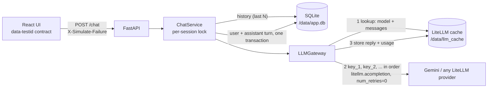

# Lyftr Relay: LLM chat with key failover and response caching

A full-stack chatbot (React + FastAPI + SQLite) whose LLM gateway, built on **LiteLLM**, keeps answering when an API key is rate-limited, out of quota or erroring, serves repeated prompts from a cache, and shows how every reply was produced: source, model, latency, per-request tokens and the route through the key pool.



## 1. Live URLs

| | URL |
|---|---|
| Frontend | https://lyftr-chat.onrender.com |
| Backend | https://lyftr-chat-api-eeog.onrender.com |
| Health | https://lyftr-chat-api-eeog.onrender.com/health |
| Demo video | `<link>` |

Both tiers run on Render (backend as a Docker web service, frontend as a static site), with `ENABLE_FAILURE_SIMULATION=true` on the backend. `python backend/scripts/contract_check.py https://lyftr-chat-api-eeog.onrender.com` passes all 26 checks against the live deployment.

> The backend runs on Render's free plan, which sleeps after 15 minutes idle. The first request after a pause can take ~50 s; open `/health` once before testing. The free plan also has no persistent disk, so live history resets on a redeploy or spin-down; locally (`make up`) it lives on the `app-data` volume and survives restarts.

## 2. Run locally: with Docker and without

### With Docker (recommended)

```bash
cp .env.example .env          # put at least two real keys in LLM_API_KEYS
make up                       # backend :8000, frontend :3000
make logs                     # follow both services
make down                     # stop (history stays in the volume)
make clean                    # stop and delete the volume
```

`make up` builds both multi-stage images and starts them with `docker-compose.yml`. SQLite and the LiteLLM disk cache live on the named volume `app-data` mounted at `/data`, so `docker compose restart` keeps every session. If Docker Hub rate-limits your pulls, set `DOCKER_REGISTRY_MIRROR=mirror.gcr.io/library/` in `.env`. If port 3000 is taken on your machine, set `FRONTEND_PORT=3001` in `.env` and add `http://localhost:3001` to `ALLOWED_ORIGINS`.

Free keys: [Google AI Studio](https://aistudio.google.com/apikey). Create each key in a **different Google Cloud project**; keys in the same project share one quota and would fail over into the same rate limit.

### Without Docker

```bash
# backend (Python 3.11+)
cd backend
python -m venv .venv && source .venv/bin/activate      # Windows: .venv\Scripts\activate
pip install -r requirements-dev.txt
export LLM_API_KEYS="key-one,key-two" ENABLE_FAILURE_SIMULATION=true \
       DATABASE_URL="sqlite:///./data/app.db" CACHE_DIR="./data/llm_cache"
uvicorn app.asgi:app --reload --port 8000

# frontend (Node 20+), in another terminal
cd frontend
npm install
npm run dev                     # http://localhost:3000, talks to http://localhost:8000 by default
```

No keys yet? `make fake-backend` starts the real API (SQLite, cache, failover, validation) with a fake provider in place of the LLM, so you can click through the whole UI offline.

### Tests

```bash
make test        # 77 backend tests (pytest) + 6 frontend tests (vitest)
make lint        # ruff + tsc
python backend/scripts/contract_check.py http://localhost:8000   # 26 black-box checks against a running backend
```

## 3. Design decisions

### Key fallback

* **Pool.** `LLM_API_KEYS` is parsed into ordered keys with stable public ids `key_1`, `key_2`, ... The secret only ever leaves `KeyPool` as the `api_key` argument to LiteLLM; `ApiKey.__repr__` hides it, and every provider error string is redacted before it reaches logs or responses.
* **Failover loop.** `LLMGateway.complete()` calls `litellm.acompletion` once per key with `num_retries=0`. Any upstream failure (LiteLLM's normalised `RateLimitError`, quota errors, `InternalServerError`, `BadGatewayError`, `ServiceUnavailableError`, timeouts, connection errors, and auth errors) moves on to the next key. A 200 with empty text also counts as a failure. If every key fails the API returns `503 {"detail": "all providers unavailable"}` and nothing is written.
  * Auth errors are on the list on purpose: Gemini reports an invalid key as HTTP 400, so treating 4xx as fatal would let one bad key take the app down. A genuinely malformed request costs at most N wasted calls, and that is the cheaper failure mode.
* **Why not `litellm.Router` fallbacks?** The contract needs, per request, *which* key answered, *how many* keys failed first, and failures injected into *specific keys for one request only*. Router reports the first two only through async callbacks, and its cooldowns are global, so a simulated 429 would leak into later requests. Driving `acompletion` per key keeps everything LiteLLM is good at (provider abstraction, exception mapping, usage accounting, the cache) and makes failover deterministic and testable.
* **Simulated failures go through LiteLLM.** For `X-Simulate-Failure: key_1=429` the gateway passes `mock_response=litellm.RateLimitError(...)` to that key's call, so a simulated 429 takes the same path as a real one. The header is honoured only when `ENABLE_FAILURE_SIMULATION=true`, malformed pairs are ignored, a specific key beats `*`, and a request with an active simulation skips the cache *read* so the failover path really runs.
* **Key health (beyond the brief).** A key that returns a real 429 rests for `KEY_COOLDOWN_SECONDS` (or the provider's `Retry-After`); a 401/403 rests longer. Resting keys are tried *last*, not skipped, so a burst of 429s stops costing every request a wasted round-trip while a 503 is still only returned after every key was tried. 5xx and timeouts are treated as transient (no cooldown). Simulated failures never touch health. `/health` shows per-key state.

### Caching

* **LiteLLM's built-in cache**, `Cache(type="disk")` under `/data/llm_cache` (or `local` in-memory via `CACHE_TYPE`). The disk backend means cache hits survive restarts, like history.
* **Cache key** is LiteLLM's own `get_cache_key` over `model + messages` (system prompt + history window + new message) plus the fixed sampling params. The API key is not part of it, so a reply produced by `key_2` is a hit for a request first routed to `key_1`. With per-key models (`LLM_KEY_MODELS`) the lookup checks each distinct model in pool order.
* **Explicit read/write.** With `caching=True`, LiteLLM writes the cache in a background task, so an identical request a few milliseconds later can still miss. The gateway calls the same LiteLLM `Cache` object directly and awaits the write before responding, which makes "send it twice, the second is `LLM_CACHE`" deterministic.
* **On a hit:** identical reply text, the token usage stored with the cached response, `key_id: null`, `fallback_attempts: 0`. A hit costs ~3 ms against hundreds of ms or more live.
* **Version pin.** `litellm==1.100.5`: newer releases dropped the disk backend, and their cache-hit path imports proxy-only modules that the plain SDK install doesn't ship (it crashes with `ModuleNotFoundError: orjson`). Both were verified before pinning.

### SQLite session storage

* **Schema** (created on startup): the required `messages` table plus a `sessions` table (`id`, `system_prompt`, timestamps) and an index on `(session_id, id)`. WAL mode, foreign keys on.
* **Atomic turns.** The user message and the assistant reply are inserted in **one transaction, after** the LLM call succeeds. A 422 or 503 therefore leaves no trace, and history never contains a question without its answer.
* **Per-session ordering.** An `asyncio.Lock` per session id (in a `WeakValueDictionary`, so idle locks disappear) serialises concurrent messages in one chat. Without it, two fast messages would each be answered without the other in context.
* **Context window.** The last `HISTORY_MAX_MESSAGES` (default 40) stored messages are sent to the model; the full history is always stored and returned by `GET /sessions/{id}/messages`.
* **System prompt.** `system_prompt` on a request becomes that session's prompt and is remembered for later turns; it is part of the cache key but never returned by the history endpoint.
* **Concurrency model.** stdlib `sqlite3`, one short-lived connection per operation, run in the threadpool so disk I/O never blocks the event loop. The app runs as **one worker** on purpose: SQLite writes, session locks and key-health state are per-process. Scaling out would mean moving those into shared storage, which the brief rules out.

## 4. Verification

**In the UI** (`http://localhost:3000` or the live frontend):

1. **Per-message tokens.** Send any message. Under the reply: the `LIVE_INFERENCE` badge, model, latency and `Tokens 42 in, 9 out` for *that request only*. The input count grows on later turns because the history is sent; it never accumulates across replies.
2. **Cache hit.** Click *Start a new chat* and send the same first message. The badge turns amber (`LLM_CACHE`), the text is identical, latency drops to a few ms, and the route reads *Cache hit, no key used*.
3. **Failover.** In *Simulate key failures*, set `key_1` to `429` and send a new message. The route trace shows `key_1 429 simulated ── key_2 answered`. Try `500`, `502`, `503`.
4. **All keys down.** Set *All keys* to `429`. The chat shows a readable `HTTP 503` message listing every key that failed, and the message is not saved.
5. **Memory.** Say "My name is Nitya", then ask "What is my name?". Sessions are isolated: a new chat doesn't know it.

**With curl** (replace `$API` with the backend URL):

```bash
curl -s $API/health

# live, then cache hit from a different session
curl -s -X POST $API/chat -H 'Content-Type: application/json' \
  -d '{"session_id":"s-a","message":"What is the capital of France?"}'
curl -s -X POST $API/chat -H 'Content-Type: application/json' \
  -d '{"session_id":"s-b","message":"What is the capital of France?"}'     # "resolution_source":"LLM_CACHE"

# failover: answered by key_2, fallback_attempts 1
curl -s -X POST $API/chat -H 'Content-Type: application/json' -H 'X-Simulate-Failure: key_1=429' \
  -d '{"session_id":"s-c","message":"Name a prime number."}'

# every key fails: 503, nothing stored
curl -s -i -X POST $API/chat -H 'Content-Type: application/json' -H 'X-Simulate-Failure: *=429' \
  -d '{"session_id":"s-d","message":"hello"}'
curl -s -i $API/sessions/s-d/messages                                       # 404 session not found

# history, oldest first, no system prompt
curl -s $API/sessions/s-a/messages
```

**Everything at once:** `python backend/scripts/contract_check.py $API` runs 26 checks covering health, live vs cache, identical replies, cache speed, multi-turn memory, history, both failover cases, 503 without side effects, the 422 cases and 404.

## 5. Setup Used

* **Editor:** `<your editor, e.g. VS Code>`
* **AI tools:** Claude (Anthropic) as a pair programmer: architecture, implementation, tests and documentation, with every behaviour verified by running the test suites, the contract checker, a Docker run and a browser walkthrough.
* **Stack:** Python 3.12, FastAPI, LiteLLM 1.100.5, SQLite; React 19, TypeScript, Vite; Docker Compose, nginx.

## 6. Bonus features

* **Route trace in the UI.** Each reply draws the path it took (`key_1 429 ── key_2 answered`, or *Cache hit*), so failover is visible without reading JSON. 503 errors show which keys failed and offer *Send again*.
* **Failure simulator panel.** Per-key and all-keys toggles that send `X-Simulate-Failure`, plus a live key-pool panel fed by `/health`, so the demo needs no curl.
* **Key cooldown with `Retry-After`.** Real rate-limited keys stop costing a round-trip on every request (see design decisions).
* **Multi-model pools.** `LLM_KEY_MODELS` lets keys target different models or providers, e.g. Gemini primary with Groq as fallback, with per-model cache lookups.
* **Disk cache that survives restarts**, on the same volume as SQLite.
* **Hardening.** Secrets redacted from every error path; JSON-only errors including 404/405/500; non-root container user; image healthchecks; `X-Request-ID` and `Server-Timing` headers plus one structured log line per request.
* **Safe concurrency.** Per-session locks keep fast consecutive messages in order.
* **Runtime-configurable frontend image.** `API_BASE_URL` is written into `/config.js` when the container starts, so one image works against any backend.
* **Test depth.** 77 backend tests (contract, validation edges, every failover status, real vs simulated failures, cooldowns, redaction, cache semantics, restarts, concurrency), 6 UI tests on the `data-testid` contract, a deploy-time contract checker, and GitHub Actions CI (ruff, pytest, tsc, vitest, Docker build).
* **Offline mode** (`make fake-backend`) for UI work without keys.

## Repository layout

```
backend/
  app/
    main.py            FastAPI app, endpoints, error handlers, CORS
    chat_service.py    one chat turn: prompt, history window, gateway, persist
    db.py              SQLite schema + queries
    schemas.py         request/response models (contract field names)
    config.py          env configuration
    llm/
      gateway.py       LiteLLM cache + ordered key failover
      key_pool.py      key ids, health, cooldowns
      simulation.py    X-Simulate-Failure parsing
  tests/               pytest suite
  scripts/             contract_check.py, fake_provider_server.py
frontend/
  src/                 App, components (Messages, RouteTrace, Composer, ControlPanel), api client, tests
  nginx.conf, docker-entrypoint.d/   runtime config injection
docker-compose.yml  Makefile  .env.example  render.yaml  docs/deployment.md
```
